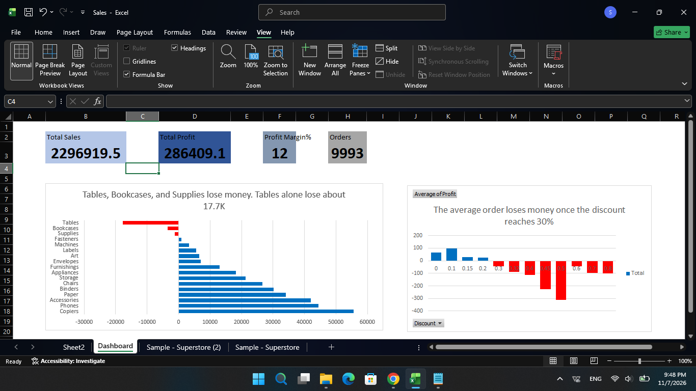

# Superstore Sales Dashboard (Excel)

An Excel analysis of a public retail dataset, built to answer one business question.

## Business question
Which categories and regions make or lose profit, and are discounts the cause?

## Answer
On average, orders stop being profitable once the discount reaches 30%. Tables, Bookcases, and the Central region discount the most and earn the least. Supplies loses money even with low discounts, so discounts do not explain every loss.

## Dashboard

Total sales: 2,296,919 | Total profit: 286,409 | Profit margin: 12.5% | Orders: 9,993

## Key findings
- **Categories:** Technology earns the most profit. No category loses money overall, but Furniture's margin is only about 2.5%, versus about 17% for Technology and Office Supplies.
- **Sub-categories:** Three lose money: Tables (about -17.7K), Bookcases (about -3.5K), and Supplies (about -1.2K). The losses in Tables and Bookcases explain Furniture's low margin.
- **Discounts:** Average profit per order is positive up to a 20% discount and negative from 30%. The worst loss is at about a 50% discount. Very high discounts are rare, but they lose money.
- **Discounts by sub-category:** Tables (26%) and Bookcases (21%) have high average discounts. Supplies has only 7% and still loses money.
- **Regions:** Central has the lowest margin (about 8%) and the highest average discount (24%). West has the highest margin (about 15%) and the lowest average discount (10%). With only four regions, this is a pattern, not proof of cause.

## Data
Superstore Dataset (Final) from [Kaggle](https://www.kaggle.com/datasets/vivek468/superstore-dataset-final). 9,993 rows covering 2014 to 2017, 20 columns. The dataset has no cost column.

## Cleaning steps (Power Query)
1. Checked column quality: no errors or empty values.
2. Changed Order Date and Ship Date to Date using the English (United States) locale (month/day/year). No errors.
3. Changed Sales, Profit, and Discount to Decimal Number, Quantity to Whole Number, and Postal Code to Text.
4. Removed duplicate rows (applied to all columns). Final: 9,993 rows.
5. Removed the Country column (single value: United States).
6. Loaded the data as an Excel Table named Sales.

## Method
Pivot Tables and PivotCharts for profit and margin by category, sub-category, and region, and for profit by discount level. Margin = profit / sales.

## Limitations
- The dataset has no cost column, so the cause of the Supplies loss cannot be determined.
- The findings show an association between discounts and losses, not proof of cause.
- There are only four regions, so the regional pattern is based on four data points.

## Tools
Excel (Power Query, Pivot Tables, PivotCharts)

## Files
- `Superstore_Dashboard.xlsx`: the workbook
- `dashboard.png`: dashboard screenshot

Built by Sarah Rashad
